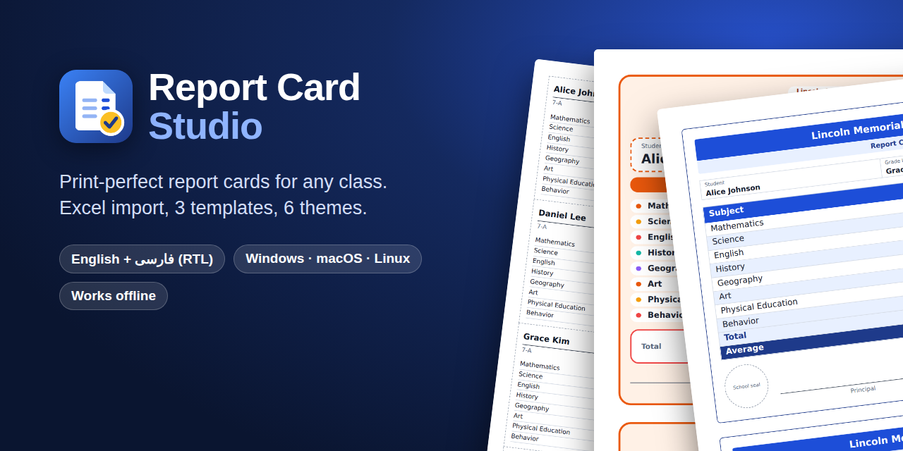
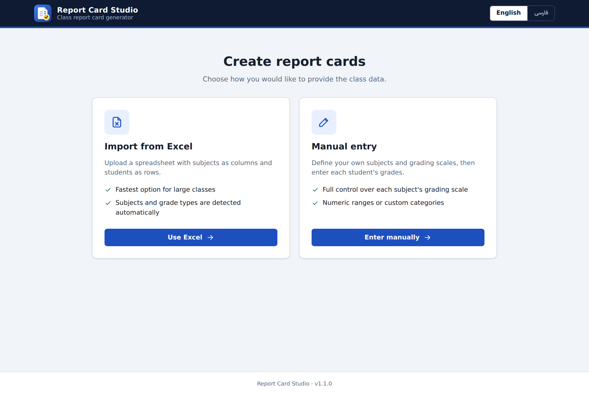
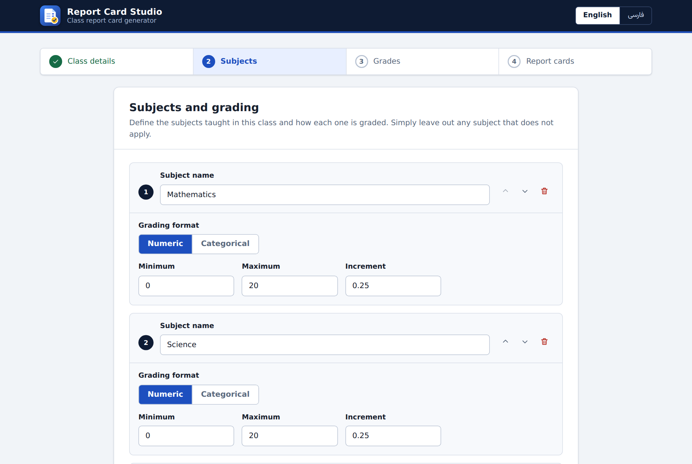
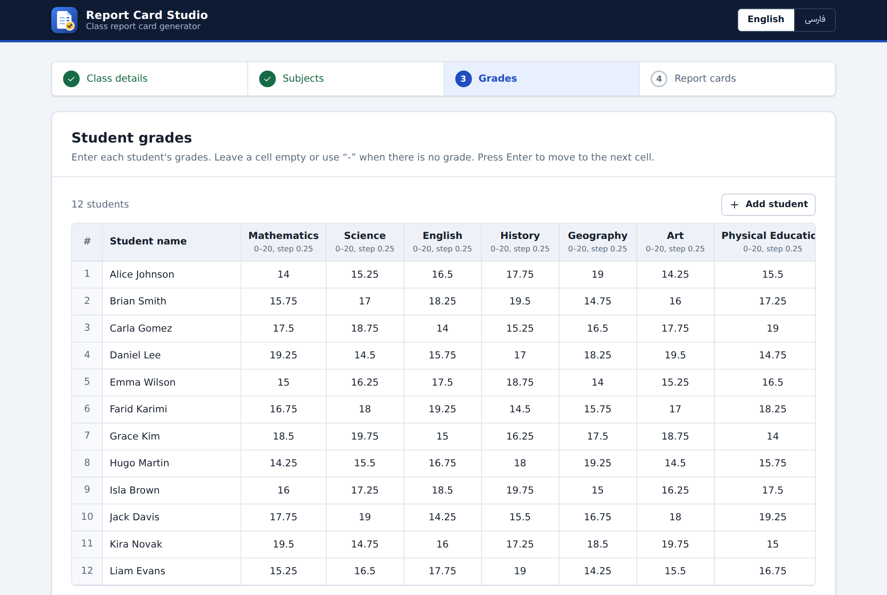
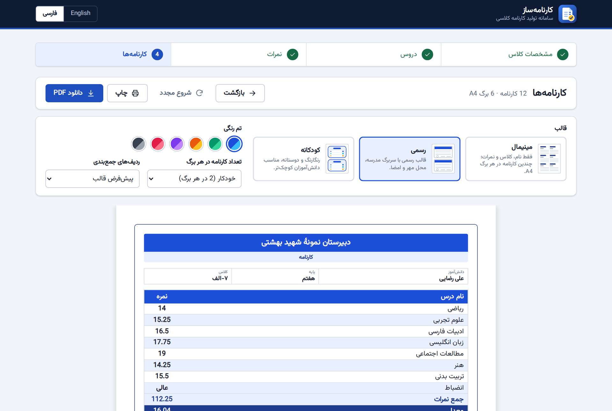
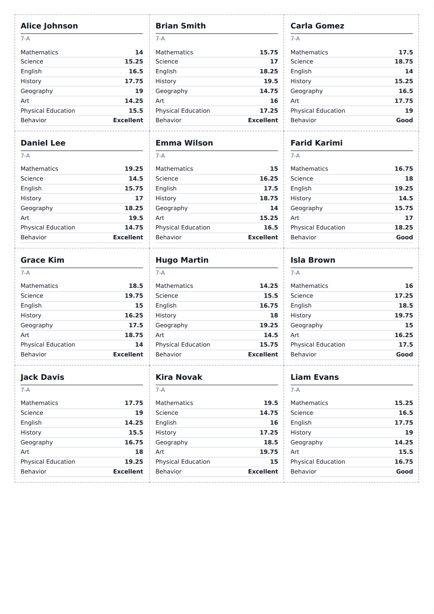
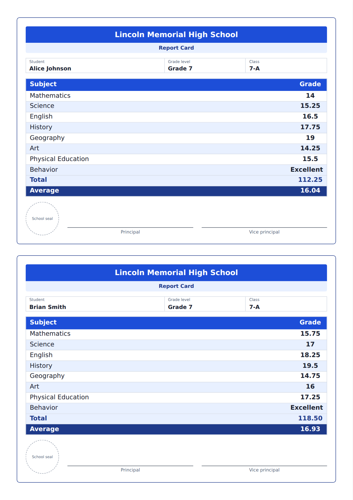
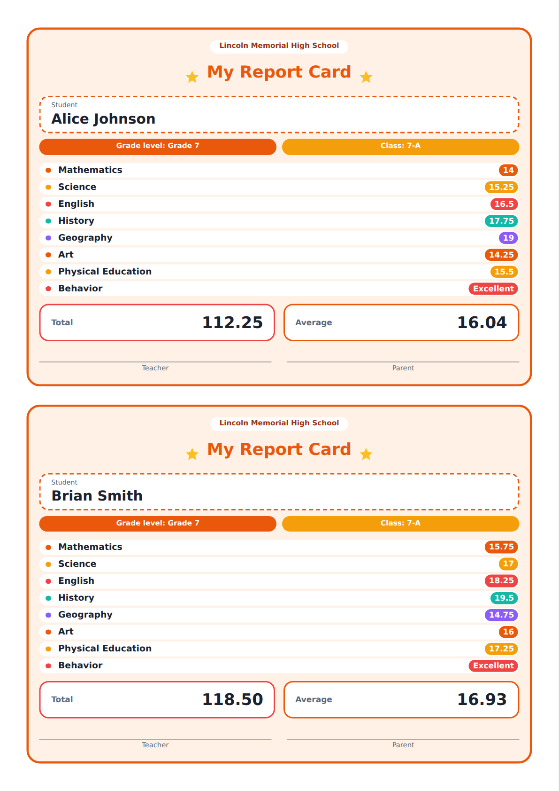
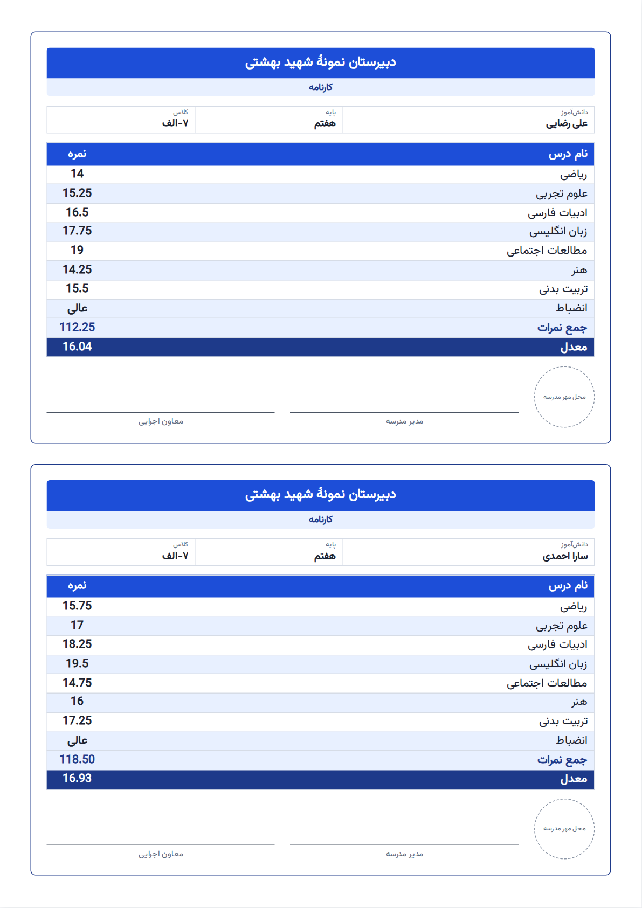
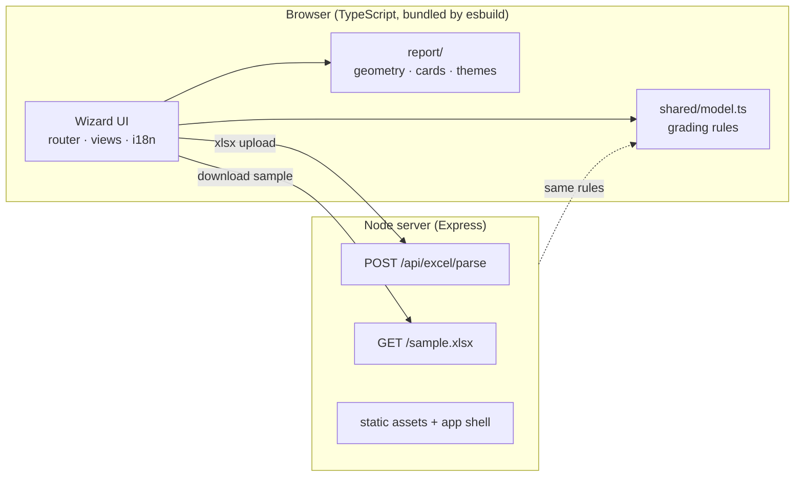

<div align="center">


### Print-perfect student report cards from Excel or manual entry

English and Persian (RTL) · 3 templates · 6 themes · works offline · one-file executables for Windows, macOS and Linux

[](https://github.com/sobhanmohammadi-dev/ReportCardStudio/actions/workflows/ci.yml)
[](https://github.com/sobhanmohammadi-dev/ReportCardStudio/releases/latest)
[](https://github.com/sobhanmohammadi-dev/ReportCardStudio/releases)
[](LICENSE)
[](tsconfig.json)
[](package.json)
[](#docker)
[](#languages)
[](CONTRIBUTING.md)



</div>

---

## Table of contents

- [Why Report Card Studio](#why-report-card-studio)
- [Features](#features)
- [Screenshots](#screenshots)
- [Quick start](#quick-start)
- [How it works](#how-it-works)
  - [Manual entry](#manual-entry)
  - [Excel import](#excel-import)
- [Templates and themes](#templates-and-themes)
  - [Cards per sheet](#cards-per-sheet)
  - [Printing and PDF](#printing-and-pdf)
- [Languages](#languages)
- [Command line, environment and Docker](#command-line-environment-and-docker)
- [Architecture](#architecture)
- [The A4 layout engine](#the-a4-layout-engine)
- [Adding a template](#adding-a-template)
- [Testing](#testing)
- [Benchmarks](#benchmarks)
- [CI/CD and releases](#cicd-and-releases)
- [Privacy and security](#privacy-and-security)
- [Troubleshooting](#troubleshooting)
- [Contributing](#contributing) · [License](#license)

## Why Report Card Studio

Schools differ in what they grade and how: a numeric 0-20 scale for maths, "Excellent / Good / Needs work" for behaviour,
a subject that does not exist in the next class. Most tools force a fixed list of subjects. **Report Card Studio lets you
describe your own classroom**, then turns the grades into clean A4 pages you can print immediately: from a compact
sheet with a dozen cards you cut apart, to a formal card with seal and signatures, to a colourful one for young children.

## Features

| | |
|---|---|
| **Two ways in** | Import an Excel sheet, or enter everything by hand in a guided wizard. |
| **Your subjects, your scales** | Only the subjects you add appear. Each is *numeric* (min, max, increment) or *categorical* (your own options; `-` = "no grade" is always available). |
| **Correct averages** | Only numeric grades count toward total and average; `-` and categorical grades never do. |
| **Three templates** | **Minimal** (name, class, grades: up to 21 cards per A4 sheet), **Professional** (school header, seal, signatures) and **Playful** (rounded, colourful, for younger children). |
| **Six themes** | Ocean, Emerald, Sunset, Royal, Rose and Graphite (ink-friendly greyscale). Every theme works with every template. |
| **Sizing that just fits** | Row heights, fonts and spacing are computed in millimetres so cards never overflow and never leave oversized gaps. Long names shrink to fit instead of being cut. |
| **Bilingual** | Full English and Persian interface with right-to-left layout, Persian digits accepted in Excel and typed grades. English is the default. |
| **Print or PDF** | Browser print (vector) or one-click PDF download. |
| **Private and offline** | Everything runs on your machine. No accounts, no cloud, no tracking. |
| **Easy to ship** | One-file executables, a portable Node bundle and a Docker image, built by GitHub Actions. |

## Screenshots

<table>
  <tr>
    <td width="50%"><br><sub><b>1.</b> Start with Excel or manual entry.</sub></td>
    <td width="50%"><br><sub><b>2.</b> Define your own subjects and grading scales.</sub></td>
  </tr>
  <tr>
    <td width="50%"><br><sub><b>3.</b> Enter grades in a keyboard-friendly grid.</sub></td>
    <td width="50%"><br><sub><b>4.</b> Persian (RTL) interface, one click away.</sub></td>
  </tr>
</table>

### Templates

<table>
  <tr>
    <td width="33%" align="center"><br><b>Minimal</b><br><sub>15 cards on one A4 sheet (8 subjects)</sub></td>
    <td width="33%" align="center"><br><b>Professional</b><br><sub>2 cards per sheet, seal and signatures</sub></td>
    <td width="33%" align="center"><br><b>Playful</b><br><sub>Colourful cards for young children</sub></td>
  </tr>
</table>

<p align="center"><br><sub>The same template in Persian: columns, seal and signatures mirror automatically.</sub></p>

## Quick start

### Option 1: download a ready-made app (no installation)

Grab the file for your system from the [latest release](https://github.com/sobhanmohammadi-dev/ReportCardStudio/releases/latest):

| System | File |
|---|---|
| Windows 10/11 (x64) | `report-card-studio-vX.Y.Z-windows-x64.zip` |
| macOS (Apple silicon / Intel) | `…-macos-arm64.zip` / `…-macos-x64.zip` |
| Linux (x64 / arm64) | `…-linux-x64.tar.gz` / `…-linux-arm64.tar.gz` |
| Any system with Node 18+ | `…-node.zip` (run `start.sh` or `start.cmd`) |

Unzip, run `report-card-studio` (`.exe` on Windows). Your browser opens at `http://localhost:8080`.
See [Troubleshooting](#troubleshooting) if Windows SmartScreen or macOS Gatekeeper asks for confirmation.

### Option 2: Docker

```bash
docker run --rm -p 8080:8080 ghcr.io/sobhanmohammadi-dev/ReportCardStudio:latest
# then open http://localhost:8080
```

### Option 3: from source

```bash
git clone https://github.com/sobhanmohammadi-dev/ReportCardStudio.git
cd report-card-studio
npm install
npm run build      # compiles the server (tsc) and bundles the client (esbuild)
npm start          # http://localhost:8080
```

Requires Node.js 18 or newer (22 recommended). `npm run dev` rebuilds the client and starts the server with `tsx`.

## How it works

Both paths share the same first step, **class details**: school name, grade level (free text, e.g. "Year 9") and class name.

### Manual entry

1. **Subjects.** Add only the subjects this class has. For each one choose a format:
   - **Numeric**: set the minimum, maximum and increment (for example 0 to 20 in steps of 0.25). Grades outside the range or not on the increment are rejected.
   - **Categorical**: type your own options (for example *Excellent*, *Good*, *Needs improvement*). A default `-` ("no grade") option is always present.
   - Reorder or remove subjects freely (omit P.E. if the class has none). Names must be unique.
2. **Grades.** Enter students one by one in a grid. **Enter** moves to the next cell and adds a new student after the last one. Invalid cells are highlighted with an explanation; blank rows are ignored.
3. **Report cards.** Pick a template and theme, then print or download.

### Excel import

Create an `.xlsx` file (max 10 MB) in this layout:

|   | **A** | **B** | **C** | **D** |
|---|---|---|---|---|
| **1** | *(leave empty)* | Mathematics | Science | Behavior |
| **2** | Alice Johnson | 18 | 17.5 | Excellent |
| **3** | Brian Smith | 16 | `-` | Good |

- Cell **A1 stays empty**; row 1 from column **B** lists the subjects; column **A** from row 2 lists the students.
- A column containing only numbers is **numeric**; any text makes it **categorical** (its options are the distinct values found).
- Empty cells and `-` mean "no grade". Persian and Arabic digits (`۱۷٫۵`) are understood.
- Download a ready-made example from the upload page (English or Persian), or from `/sample.xlsx?lang=en`.

After upload you get a **review** step showing the detected subjects, their types and a preview of the students.

## Templates and themes

| Template | Best for | Contents | Layouts |
|---|---|---|---|
| **Minimal** | Printing a whole class on few sheets, cutting cards apart | Student name, class name, subjects and grades. Optional summary rows. Dashed cut lines. | 2, 3, 4, 6, 8, 9, 10, 12, 15, 18 or 21 per sheet |
| **Professional** | Formal distribution | School header, student/grade/class strip, zebra table, total and average, seal circle, principal and vice-principal signature lines | 1 or 2 per sheet |
| **Playful** | Primary-school children | Rounded card with stars, colour-coded subject pills and score badges, total and average pills, teacher and parent signature lines | 1 or 2 per sheet |

Your template and theme choice is remembered between sessions. The **Summary rows** option switches between
*template default*, *none*, *average only* and *total and average* (hidden automatically if no subject is numeric).

### Cards per sheet

The default is **Auto**: the densest layout whose text stays comfortably readable (at least about 8 pt for Minimal).
You can override it; layouts that would make text too small are disabled in the menu. Measured result of `Auto`
for common subject counts (summary rows at their template default; value in brackets is the resulting body font size):

| Subjects | Minimal | Professional | Playful |
|---|---|---|---|
| 3 | 21 (10.2 pt) | 2 (11.1 pt) | 2 (11.6 pt) |
| 6 | 18 (8.0 pt) | 2 (11.1 pt) | 2 (11.6 pt) |
| 9 | 12 (9.4 pt) | 2 (9.8 pt) | 1 (17.9 pt) |
| 12 | 9 (10.2 pt) | 2 (7.9 pt) | 1 (17.9 pt) |
| 15 | 9 (8.5 pt) | 1 (15.3 pt) | 1 (17.9 pt) |
| 20 | 4 (10.1 pt) | 1 (15.3 pt) | 1 (14.3 pt) |

### Printing and PDF

- **Print** uses the browser's own engine and produces sharp vector text. Choose paper size **A4**, scale **100 %**
  and leave margins at *Default* or *None* (the page sets its own margins). Background graphics are enabled automatically.
  To get a PDF, choose "Save as PDF" in the print dialog.
- **Download PDF** renders each sheet to an image and assembles a PDF without any server round-trip. It is convenient,
  but text is rasterised (2.5x); prefer *Print → Save as PDF* when you need the crispest output or small file sizes.

## Languages

The interface is available in **English** (default) and **Persian (فارسی)**. Switch with the toggle in the top bar;
the choice is remembered. Persian switches the whole UI and the report cards to right-to-left. All strings live in
[`src/client/i18n.ts`](src/client/i18n.ts); the compiler enforces that both languages define every key.

## Command line, environment and Docker

```text
report-card-studio [options]

  -p, --port <n>     Listen on this port (default: first free port in 8080-8090)
      --host <addr>  Interface to bind (default: 127.0.0.1)
      --no-open      Do not open the browser automatically
  -v, --version      Print the version and exit
  -h, --help         Show help
```

| Variable | Meaning |
|---|---|
| `PORT`, `HOST` | Same as `--port` / `--host` |
| `NO_BROWSER=1` | Same as `--no-open` |
| `QUIET=1` | Silence per-request logs |

### Docker

```bash
docker run --rm -p 8080:8080 ghcr.io/sobhanmohammadi-dev/ReportCardStudio:latest
docker build -t report-card-studio .          # build locally
```

The image is a small Alpine image holding a single bundled server file (no `node_modules`). It runs as the unprivileged
`node` user and has a health check on `/api/health`.

## Architecture



The server is deliberately thin: it parses Excel files, generates the sample workbook and serves static files. The wizard,
validation and report rendering all run in the browser, so reports are generated instantly and nothing is stored on the server.

```text
src/
  shared/    model.ts (grading rules, validation, summaries)   persianDate.ts (Jalali helpers, currently unused)
  server/    app.ts (routes)   main.ts (CLI, port search)   excel.ts (parse + sample file)
  client/    main.ts (hash router)   i18n.ts   state.ts   layout.ts   views/*   report/{geometry,cards,themes}.ts
static/      css/app.css (app chrome)   css/report.css (printable sheets)   js/ (vendor libs + built app.js)
templates/   index.html (app shell)
test/        unit, integration and browser layout tests
scripts/     build, benchmarks, screenshots, asset generation
.github/     CI, release and Dependabot configuration
```

## The A4 layout engine

Print layouts are fragile, so sizing is not left to chance. Every dimension in `static/css/report.css` is in millimetres and
derives from one variable, `--r` (the row height). [`geometry.ts`](src/client/report/geometry.ts) solves for the
largest `--r` that lets a card fill its grid cell exactly:

```
r = (cellHeight − fixedHeight − safety) / (subjects + extra rows)        clamped to [rMin, rMax]
```

- `fixedHeight` is everything that does not scale (headers, seal, signatures, padding), declared per template.
- `rMax` caps row height so a card with few subjects is not stretched; `rMin` is the smallest readable size.
- Long student, school and subject names are scaled down (never below 62 %) before falling back to an ellipsis.
- Cards that are shorter than their cell are centred (multi-up) so spacing stays even.

Because the numbers come from the same formula the CSS uses, a card **cannot overflow by construction**, and the
browser layout test (below) proves it for every combination.

## Adding a template

1. Add an id and a `TemplateSpec` to `TEMPLATES` in `src/client/report/geometry.ts` (grids, margins, `fixed`, `units`, `rMin`, `rAuto`, `rMax`).
2. Write a builder in `src/client/report/cards.ts` and register it in `renderCard`.
3. Add styles to `static/css/report.css` using `calc(var(--r) * …)` for anything that scales. Use a unique class prefix: a test fails if `report.css` and `app.css` share a class name.
4. Add `tpl.<id>` and `tpl.<id>.desc` to **both** languages in `i18n.ts` and a thumbnail in `views/report.ts`.
5. Run `npm test` and `npm run test:layout`. Add the id to `TEMPLATE_IDS` in `views/report.ts` if you want it selectable.

## Testing

```bash
npm run typecheck     # server, client and test projects (strict)
npm test              # 23 unit + integration tests
CHROME_PATH=/path/to/chrome npm run test:layout   # real-browser layout verification
```

| Suite | What it proves |
|---|---|
| `test/model.test.ts` | Number parsing (including Persian digits), range/increment validation, "no grade" handling, total/average only over numeric grades, subject validation. |
| `test/geometry.test.ts` | Every grid tiles A4 exactly; a card never exceeds its cell for 1-60 subjects; `auto` never picks unreadable text; more subjects never mean more cards per sheet. |
| `test/excel.test.ts` | The documented Excel format, type inference, Persian digits, blank rows, and every error code. |
| `test/server.test.ts` | App shell, assets, health, upload success and failure codes, sample download. |
| `test/css-collisions.test.ts` | App and report stylesheets never share a class name (added after a real collision made grade badges render misplaced). |
| `test/layout.e2e.mjs` | Renders **1,152 configurations** (2 languages × 3 templates × every cards-per-sheet value × 8 subject counts × 4 summary modes) in Chrome and asserts: sheet is exactly A4, cards per sheet is right, no card exceeds its cell, no element leaves its row, no text is truncated for realistic names. A built-in negative control (`LAYOUT_BREAK=1`) must fail, so the test cannot pass vacuously. |

## Benchmarks

Numbers below were **measured, not estimated**, with [`scripts/bench.mjs`](scripts/bench.mjs) on version 1.1.0 in a small
virtual machine: *Intel Xeon @ 2.8 GHz, 1 vCPU, 4 GB RAM, Linux x64, Node 22.22, HeadlessChrome 153*. A laptop or desktop
will be considerably faster; treat these as a conservative floor. Raw data: [`docs/benchmarks.json`](docs/benchmarks.json).

### Excel import (15 subjects, median of 5 runs)

| Students | File size | Parse time | Throughput |
|---|---|---|---|
| 100 | 14 KB | 37 ms | 2,737 students/s |
| 1,000 | 75 KB | 171 ms | 5,860 students/s |
| 5,000 | 349 KB | 788 ms | 6,343 students/s |

### Rendering report cards in the browser (10 subjects, Auto layout)

| Template | Students | Sheets | Build | Layout | Paint | **Total** |
|---|---|---|---|---|---|---|
| Minimal | 30 | 3 | 14 ms | 10 ms | 18 ms | **42 ms** |
| Minimal | 300 | 25 | 34 ms | 141 ms | 51 ms | **226 ms** |
| Minimal | 3,000 | 250 | 246 ms | 1,700 ms | 524 ms | **2.5 s** |
| Professional | 30 | 15 | 9 ms | 26 ms | 18 ms | **53 ms** |
| Professional | 300 | 150 | 38 ms | 197 ms | 52 ms | **287 ms** |
| Professional | 3,000 | 1,500 | 412 ms | 1,711 ms | 534 ms | **2.7 s** |
| Playful | 30 | 30 | 8 ms | 17 ms | 7 ms | **32 ms** |
| Playful | 300 | 300 | 122 ms | 326 ms | 115 ms | **563 ms** |
| Playful | 3,000 | 3,000 | 690 ms | 3,060 ms | 1,205 ms | **5.0 s** |

A typical class (30 students) renders in well under 100 ms. Even a 3,000-student cohort renders in a few seconds on this modest VM.

### Print to PDF (Chromium's print engine, what the *Print* button uses)

| Template | Students | Sheets | Time | PDF size |
|---|---|---|---|---|
| Minimal | 30 | 3 | 0.2 s | 0.18 MB |
| Minimal | 300 | 25 | 1.4 s | 1.73 MB |
| Professional | 30 | 15 | 0.3 s | 0.47 MB |
| Professional | 300 | 150 | 3.0 s | 4.50 MB |

The Minimal template needs **6x fewer sheets** than Professional for the same class (25 vs 150 for 300 students), which is the point of it.

### Server, bundle and executable

| Metric | Result |
|---|---|
| Server cold start (Node) | 823 ms |
| Server memory after start (RSS) | 81 MB |
| `GET /api/health` latency | p50 1.5 ms · p95 6.1 ms |
| `GET /` latency | p50 1.3 ms |
| `POST /api/excel/parse` with 1,000 students (upload + parse + response) | 266 ms |
| Browser bundle `app.js` | 92.7 KB (22.4 KB gzip) |
| Stylesheets (app + report) | 26.5 KB (5.9 KB gzip) |
| Linux x64 executable | 72.9 MB (includes the Node runtime), starts in 286 ms, 91 MB RSS |

Reproduce:

```bash
npm run build
node scripts/bench.mjs                                  # Excel + server + bundle sizes
CHROME_PATH=/path/to/chrome node scripts/bench.mjs      # + rendering and print-to-PDF
BINARY=release/report-card-studio-linux-x64 node scripts/bench.mjs   # + executable startup
```

## CI/CD and releases

Two GitHub Actions workflows live in [`.github/workflows`](.github/workflows):

**`ci.yml`**: runs on every push to `main` and every pull request.

| Job | What it does |
|---|---|
| Test | Type-check, unit and integration tests, and build on Ubuntu, Windows and macOS (Node 22) plus Ubuntu on Node 20. |
| A4 layout checks | Runs the 1,152-configuration layout test in the runner's real Chrome. |
| Standalone executable | Packages the Linux executable and boots it, requesting the page, the script, the font and the sample file. |
| Docker image | Builds the image and checks that the container answers its health check. |

**`release.yml`**: runs when you push a tag such as `v1.2.0` (or manually with a tag input). It re-runs tests and the layout check, then builds in parallel:

| Artifact | Built on |
|---|---|
| `…-windows-x64.zip` | `windows-latest` |
| `…-macos-arm64.zip` (ad-hoc signed) | `macos-latest` |
| `…-macos-x64.zip` | `macos-15-intel` |
| `…-linux-x64.tar.gz` | `ubuntu-latest` |
| `…-linux-arm64.tar.gz` | `ubuntu-24.04-arm` |
| `…-node.zip` portable bundle | `ubuntu-latest` |
| Docker image `ghcr.io/sobhanmohammadi-dev/ReportCardStudio` (`linux/amd64`, `linux/arm64`) | `ubuntu-latest` + QEMU |
| `SHA256SUMS.txt` | release job |

Executables are produced with [`@yao-pkg/pkg`](https://github.com/yao-pkg/pkg) from a single esbuild bundle. The tag is stamped into
`package.json` before building, so the app footer, `--version` and `/api/health` all report the release version. Tags containing a
hyphen (for example `v1.2.0-rc.1`) are published as pre-releases and do not move the `latest` Docker tag.

### Cutting a release

```bash
node scripts/set-repo.mjs your-org/report-card-studio   # once: fills in the README badges and links
git tag v1.2.0 && git push origin v1.2.0
```

## Privacy and security

- All processing is local. Uploaded spreadsheets are parsed in memory and never written to disk; nothing is sent to third parties (fonts and libraries are bundled).
- The server binds to `127.0.0.1` by default, so student data is not exposed to your network. Use `--host 0.0.0.0` (or the Docker image) only on networks you trust, and put it behind your own authentication if you expose it.
- Uploads are limited to 10 MB and must be `.xlsx`.

## Troubleshooting

| Problem | Solution |
|---|---|
| **Windows SmartScreen** says "Windows protected your PC" | The executable is not code-signed. Click *More info → Run anyway*. |
| **macOS** says the app "cannot be opened" | Run `xattr -d com.apple.quarantine ./report-card-studio` once, or right-click → *Open*. |
| Browser does not open | Open the URL printed in the terminal, or start with `--no-open`. |
| "port is not available" | Another program uses it. Omit `--port` to auto-pick 8080-8090, or choose another. |
| Excel import says no subjects/students found | Check the layout: A1 empty, subjects in row 1 from column B, student names in column A from row 2. Only `.xlsx` is supported (not `.xls` or `.csv`). |
| Text looks tiny on a sheet | You chose a dense "cards per sheet" option; pick a lower number or leave it on *Auto*. |
| Backgrounds missing when printing | Enable "Background graphics" in the print dialog (Chrome and Edge do this automatically). |

## Contributing

Pull requests are welcome. Please read [CONTRIBUTING.md](CONTRIBUTING.md) first; it explains the checks that run in CI.
Version history is in [CHANGELOG.md](CHANGELOG.md).

## License

[MIT](LICENSE) © Report Card Studio contributors.
